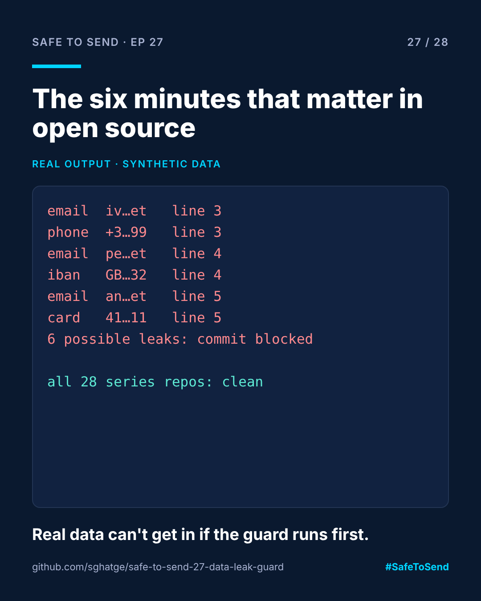

<div align="center">


**SAFE TO SEND · GOVERNED AI ENGINEERING SERIES · SAFE TO SEND 27 DATA LEAK GUARD**

[GitHub Profile](https://github.com/sghatge) · [Portfolio](https://sghatge.github.io/adobe-campaign-v8-governance/)

</div>

---

# safe-to-send-27 · Data Leak Guard



**Safe to Send · Episode 27** — a 28-day learn-in-public series on governing AI in CRM operations.

> Open source is great until someone commits a real customer export "just for testing".

## The real-world scenario

You're building CRM tools in public. A colleague wants to reproduce a bug and commits a 40-row CSV from a real export. It's on GitHub for six minutes before anyone notices. Forks and caches mean six minutes is long enough.

## What it catches

| Kind | How |
|---|---|
| Email addresses | Anything not on reserved example domains (example.com, .org, .net, .test, .invalid) |
| Phone numbers | International format |
| IBANs | Only those that pass the real mod-97 checksum, so random strings don't fire |
| Card numbers | Only those that pass the Luhn check |

Findings are printed masked (`iv…et`), so the scan output doesn't leak the data a second time.

## Run it

```bash
python leak_guard.py examples/clean_fixture    # clean
python leak_guard.py examples/leaky_fixture    # 6 findings, exit code 1
```

## Install as a pre-commit hook

```bash
cp hooks/pre-commit .git/hooks/pre-commit && chmod +x .git/hooks/pre-commit
```

## The point for this series

Every repo in Safe to Send uses synthetic data and example domains. This is the tool that keeps it that way. (The leaky fixture uses the standard published example IBAN and the well-known 4111… test card number, so nothing in it is real.)

MIT · [Sangram Ghatge](https://www.linkedin.com/in/sangram-g-2369705b) · #SafeToSend
